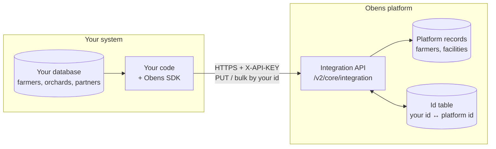
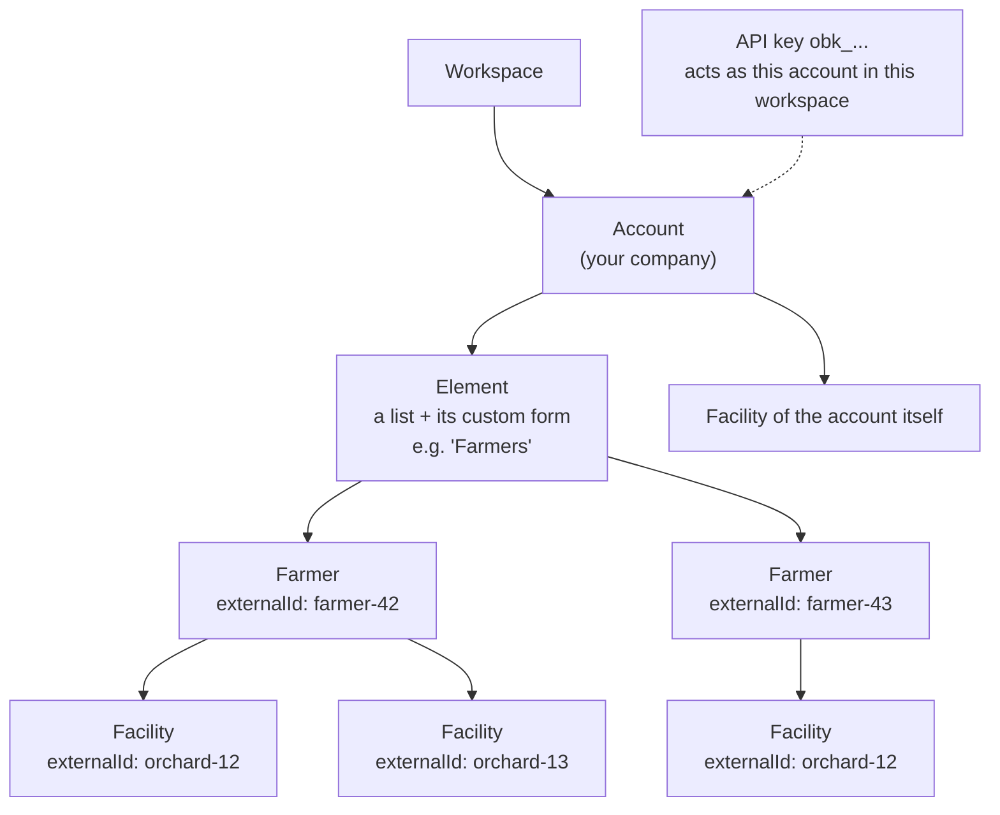
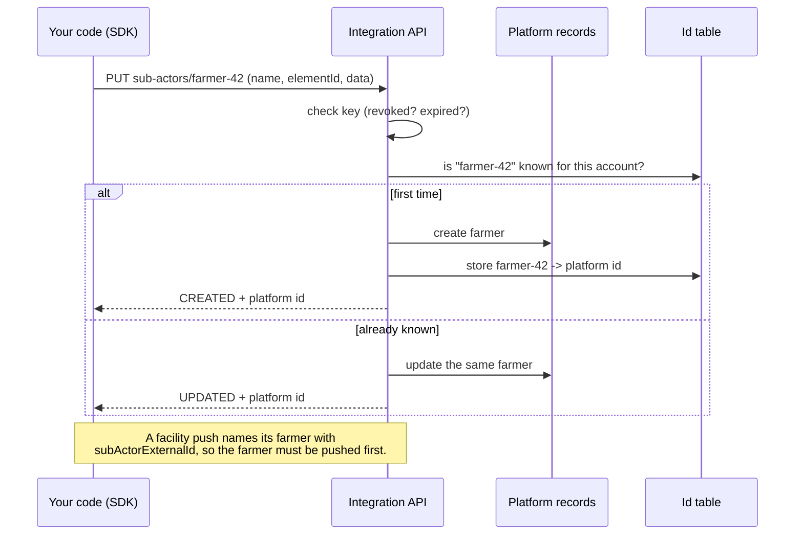
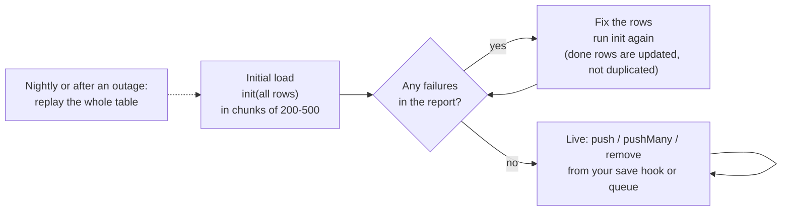
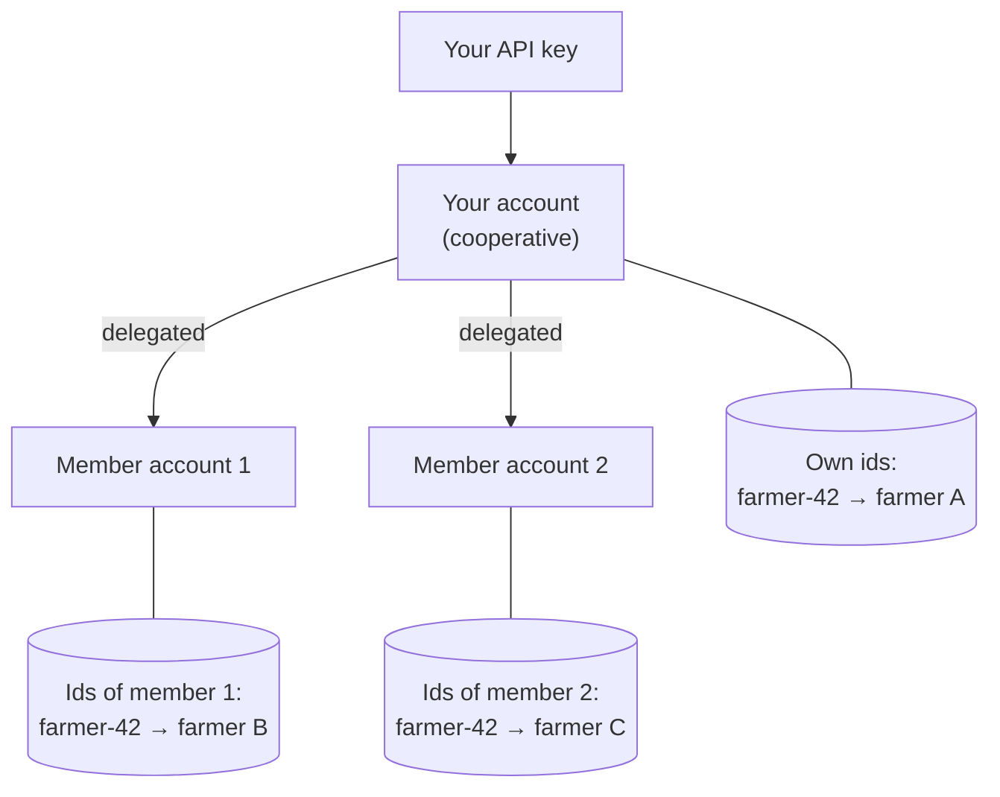
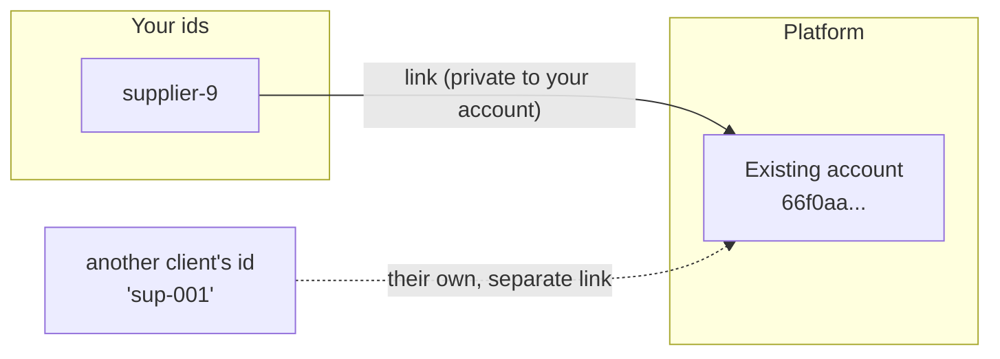

# @obens-ltd/sdk (JavaScript)

Source: https://github.com/Obens-Ltd/obens-sdk-js

Push your farmers, facilities and partners to the Obens platform under **your own ids**, and translate ids both ways.
Node 18+ (uses the built-in `fetch`), no dependencies, TypeScript types included.

The package is published to GitHub Packages. Point the `@obens-ltd` scope at it
(a GitHub token with `read:packages` is required) in your `.npmrc`:

```
@obens-ltd:registry=https://npm.pkg.github.com
//npm.pkg.github.com/:_authToken=${GITHUB_TOKEN}
```

```
npm install @obens-ltd/sdk
```

## How it fits together

Six small pictures of what happens behind the SDK (Mermaid diagrams, GitHub draws them).

### The big picture

Your system keeps its own ids. The SDK sends records with those ids to the platform; the platform stores its own id
next to yours and can translate either way.



### What an API key is allowed to touch

A key is bound to **one account in one workspace**. It can only see that account's records (plus accounts that
delegated to it, see below). Farmers live in an **element** (a list with its own custom form); facilities (orchards,
plots...) belong to a farmer.



Notice `orchard-12` twice: a facility id is unique **per owner**, so the same id under two farmers is two different
facilities. Farmers have their own id space, facilities have theirs.

### One push, step by step

The first push of an id creates the record, every later push updates it. That is why retries and full replays never
create duplicates.



### Load once, then push changes



### Acting for other accounts (delegation)

If other accounts have delegated to the key's account (a cooperative and its members, for example), the same key can
act on them. Each account has its **own** id space, so `farmer-42` of the cooperative and `farmer-42` of a member are
different farmers.



A revoked delegation answers `403` on the next call.

### Matching accounts that already exist

Accounts are shared between clients, so an account cannot carry your id. You **link** your id to it; the link is
private to your account.



## 1. Get an API key

In the platform: **Settings → API keys → Create key**. Pick the account and workspace it acts as. The secret
(`obk_...`) is shown **once**, store it like a password. Keys can be revoked or set to expire.

## 2. Connect

```js
import { ObensClient } from '@obens-ltd/sdk';

const client = new ObensClient({
  baseUrl: 'https://api.obens.so/v2/core',
  apiKey: process.env.OBENS_API_KEY,
});

console.log(await client.whoami());   // { keyId, keyName, accountId, workspaceId }
console.log(await client.elements()); // the lists farmers can be created in -> you need one `id`
```

Transient failures (timeouts, 429, 5xx) are retried with backoff. Every call is an upsert, so a retry or a replay
never duplicates a record.

## 3. Write a mapper

A mapper turns **your** record into what the platform expects. Strings are paths into your record, functions are
computed, `constant()` is a fixed value; empty results are skipped so an update never blanks a field.

```js
import { createMapper, constant } from '@obens-ltd/sdk';

const FARMERS_ELEMENT = '<element id from client.elements()>';

const mapFarmer = createMapper({
  externalId: 'id',                                  // YOUR id: required, the key of the mapping
  name: (r) => `${r.firstName} ${r.lastName}`,
  ref: 'code',
  address: 'village.name',
  gender: (r) => ({ M: 'MALE', F: 'FEMALE' })[r.sex],
  elementId: constant(FARMERS_ELEMENT),
  type: constant('FARMER'),
});
```

Or write the function yourself: `map: (r) => ({ externalId: r.id, name: r.name, ... })`.

## 4. Initial load

```js
const farmers = client.syncer('subActors', { map: mapFarmer, chunkSize: 200, onProgress: (r) => console.log(r.total) });

const report = await farmers.init(allRows);        // an array, or any (async) iterable to stream a big table
console.log(report);                               // { total, created, updated, failed, failures: [{externalId, error}] }
```

One bad row never stops the load; it is listed in `failures`. Run `init` again after fixing them: rows already pushed
are updated, not duplicated.

## 5. Push changes

```js
await farmers.push(row);          // one change, call it from your save hook / queue consumer
await farmers.pushMany(rows);     // a batch of changes
await farmers.remove(row);        // delete (soft: the platform keeps the record)
```

Facilities work the same way:

```js
const facilities = client.syncer('facilities', {
  map: createMapper({
    externalId: 'id',
    'info.name': 'title',
    'info.address': 'address',
    coordinates: (r) => ({ type__: 'Point', latitude: r.lat, longitude: r.lng }),
  }),
});
```

### Facilities of a farmer

A farmer can own many facilities (orchards, plots...). Give the farmer's external id in `subActorExternalId` and the
facility belongs to that farmer. The farmer must have been pushed first. A facility's id is unique **per owner**, so
read it back with the same farmer:

```js
createMapper({ externalId: 'id', subActorExternalId: 'farmerId', 'info.name': 'title' });
await client.facilities.get('orchard-12', { subActor: 'farmer-42' });
```

## 6. Match your ids to platform ids

```js
const ids = await client.idMap('SUB_ACTOR').load();     // 'SUB_ACTOR' | 'FACILITY' | 'ACCOUNT'
await ids.internal('farmer-42');                        // -> platform id
await ids.external('66f0c0...');                        // -> 'farmer-42'

// link one of your partners to an account that already exists on the platform
await client.accounts.link('supplier-9', '66f0aa...');
```

### Custom fields

```js
const fields = await client.subActorSchema(elementId); // [{ name, staticId, type, writable, choices }]
```

Put plain values in `data`, keyed by field `name` or `staticId`:

```js
createMapper({
  externalId: 'id',
  name: 'fullName',
  elementId: constant(ELEMENT_ID),
  data: (r) => ({ Crop: r.crop, 'Area (ha)': r.area, 'Planted on': r.planted, Variety: ['Arabica'] }),
});
```

Choices accept an option's id, label or value; quantities are `{ value, unit }`; dates are `yyyy-MM-dd`. File, image,
table and formula fields can't be written. A bad key or value fails that record with a message listing every problem;
nothing is written for it.

## Delegated accounts

If other accounts have delegated to the key's account, the same key can act on them: create their farmers and
facilities, link their partners and read their id tables.

```js
const accounts = await client.accounts.accessible();     // [{ id, name, self }]: the key's own account first
const coop = client.forAccount(accounts[1].id);          // every call below now acts as that account

await coop.syncer('subActors', { map: mapFarmer }).init(coopFarmers);
```

Each account has its **own** id space: `farmer-42` of one account and `farmer-42` of another are different farmers.
A revoked delegation stops working on the next call (`403`).

## Errors

Failed requests throw `ObensApiError` with `status` and `body`. `401` = missing, wrong, revoked or expired key.

Full endpoint reference: `traceability-core/api-docs/integration/readme.md`.

## License

MIT, see [LICENSE](LICENSE).
